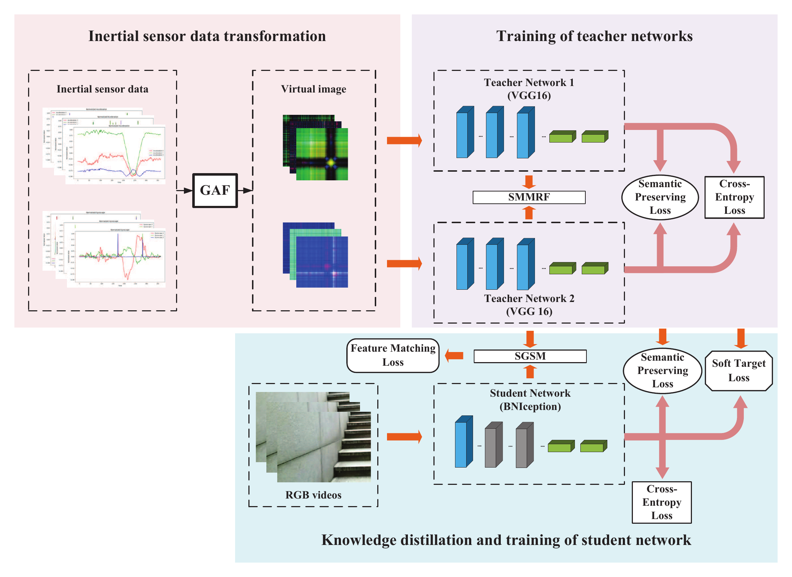
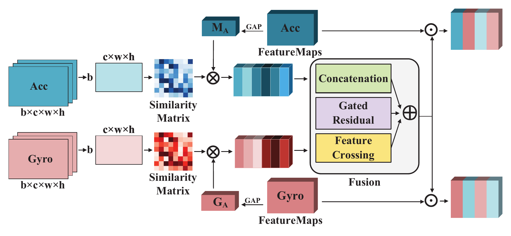
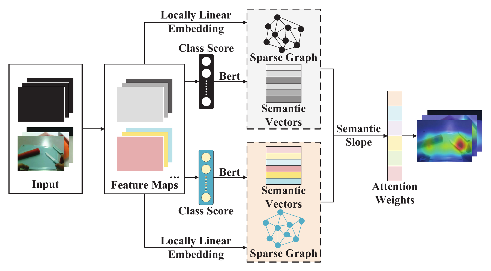

# ISVKDN

**Inertial Sensor-to-Vision Knowledge Distillation Network for Human Action Recognition**

ISVKDN transfers knowledge from inertial sensors to an RGB-video model. During training, a teacher learns from accelerometer and gyroscope signals represented as Gramian Angular Field (GAF) images. A video student learns action classification together with output-level and intermediate-feature distillation. At inference, the student recognizes actions from RGB video.

This repository provides the PyTorch training pipeline, controlled experiments, checkpoint evaluation, and timing tools for UESTC-MMEA-CL.

## Method

<p align="center">
  
</p>

*ISVKDN framework from the manuscript. The inertial teacher guides the video student through soft-label distillation, semantic feature matching, and semantic preservation.*

The implementation combines three components:

- **SMMRF:** Similarity Matrix-based Multi-Relational Fusion integrates the two inertial branches using concatenation, gated, and feature-crossing relations.
- **SGSM:** Sparse Graph-guided Semantic Mapping aligns teacher and student features using action semantics and locally linear reconstruction graphs.
- **Video student:** A Temporal Relation Network (TRN) with a BN-Inception backbone samples eight RGB frames per video and learns action classification.

<table>
  <tr>
    <td align="center" width="50%"><b>SMMRF</b></td>
    <td align="center" width="50%"><b>SGSM</b></td>
  </tr>
  <tr>
    <td></td>
    <td></td>
  </tr>
</table>

The supplied class embeddings have shape `32 × 768`. SGSM uses probability-weighted class semantics, regularized local reconstruction, and semantic-sensitivity clipping. Training supports CUDA automatic mixed precision (AMP), TF32, and persistent data-loading workers.

## Environment

The development environment uses an NVIDIA GPU with the following versions:

| Component | Version |
| --- | --- |
| Python | 3.8.19 |
| PyTorch | 1.13.0 + CUDA 11.7 |
| torchvision | 0.14.0 + CUDA 11.7 |
| NumPy | 1.24.3 |
| OpenCV | 4.7.0.72 |

Create an environment and install the dependencies:

```bash
conda create -n isvkdn python=3.8.19 -y
conda activate isvkdn
python -m pip install torch==1.13.0+cu117 torchvision==0.14.0+cu117 --extra-index-url https://download.pytorch.org/whl/cu117
python -m pip install -r requirements.txt
```

Run commands from the repository root. The training scripts require CUDA. VGG16-BN and BN-Inception load pretrained backbone weights through PyTorch's model cache; the first model construction needs those weights to be cached or downloadable.

## Data preparation

Prepare the UESTC-MMEA-CL videos and their corresponding accelerometer and gyroscope GAF images. The loader expects separate `train`, `val`, and `test` directories:

```text
GAF_ROOT/
├── Acc_train/a01/1_example_GASF_a.png
├── Acc_val/a01/1_example_GASF_a.png
├── Acc_test/a01/1_example_GASF_a.png
├── Gyro_train/g01/1_example_GASF_g.png
├── Gyro_val/g01/1_example_GASF_g.png
└── Gyro_test/g01/1_example_GASF_g.png

VIDEO_ROOT/
├── video_train/1_example.mp4
├── video_val/1_example.mp4
└── video_test/1_example.mp4
```

The filenames above illustrate the naming convention; use the actual, distinct sample identifiers in each split. Class folders are numbered from 1 to 32, and each video's identifier begins with its class number. Class 1 corresponds to row 0 of the semantic embedding matrix.

Samples are paired by identifier after removing `_GASF_a`, `_GASF_g`, `_GADF_a`, or `_GADF_g` from a GAF filename. Identifiers and labels must agree across all three modalities within each split. The loader raises an error for duplicate identifiers, unmatched samples, or inconsistent labels. Supported video extensions are `.mp4`, `.avi`, and `.mov`.

The prepared data used by the current pipeline contain **4,553 training**, **653 validation**, and **1,316 test** samples. Validation selects checkpoints; the test split is evaluated after loading the selected checkpoint. Videos are decoded directly, with one frame sampled from each of eight temporal segments. Pre-extracted frame directories are unnecessary.

The semantic resources are provided in `data/`, and the ordered action names are in [`UESTC-MMEA-CL.txt`](UESTC-MMEA-CL.txt).

## Train ISVKDN

Set the following values near the top of [`run_isvkdn.py`](run_isvkdn.py):

```python
GAF_ROOT = Path("/path/to/UESTC-MMEA_GAF")
VIDEO_ROOT = Path("/path/to/UESTC-MMEA-CL")
PREFERRED_PYTHON = Path(sys.executable)
RUN_MODE = "train"
NUM_WORKERS = 4
RETRAIN_TEACHER = False
```

Then run:

```bash
python run_isvkdn.py
```

The entry point trains the SMMRF teacher when its checkpoint is absent, trains the video student using that teacher, and evaluates the selected student checkpoint on the test split. An existing SMMRF teacher is reused when `RETRAIN_TEACHER = False`. Set it to `True` to train the teacher again.

For a quick check, set `RUN_MODE = "smoke"` and run the same command. This executes one training and one validation batch for each model without saving model checkpoints.

| Setting | Teacher | Student |
| --- | --- | --- |
| Backbone | Two VGG16-BN branches with SMMRF | BN-Inception + multiscale TRN |
| Input | Accelerometer and gyroscope GAFs | Eight RGB frames |
| Classes | 32 | 32 |
| Batch size | 16 | 16 |
| Maximum epochs | 80 | 70 |
| Initial learning rate | 0.0001 | 0.001 |
| Early-stopping patience | 10 validation epochs | 10 validation epochs |

The teacher checkpoint is saved as:

```text
output/MMEA_a_g_ISVKDN_SMMRF_epochs80_batch16_lr0.0001/st_best_acc.pth
```

The student checkpoint is saved as `best_acc.pth` in its experiment directory under `output/`. Teacher checkpoints must use the SMMRF architecture implemented in this repository.

## Controlled experiments

[`run_stage2_experiments.py`](run_stage2_experiments.py) configures the distillation losses, fusion components, semantic controls, and random seeds. Set its data paths and `PREFERRED_PYTHON` as above, then select the experiments:

```python
SELECTED_EXPERIMENTS = ["A0", "A1", "A2", "A3"]
SEEDS = [2025]
RUN_MODE = "train"
```

```bash
python run_stage2_experiments.py
```

Every student uses supervised cross-entropy. The following settings control the additional losses and modules:

| ID | Configuration |
| --- | --- |
| A0 | Video baseline |
| A1 | Soft-label distillation |
| A2 | SGSM feature matching |
| A3 | Full ISVKDN |
| B0 | Mean inertial fusion with full distillation |
| B1 | Concatenation fusion with full distillation |
| B2 | Concatenation and gating with full distillation |
| B3 | Full SMMRF with full distillation |
| C0 | Soft-label distillation and semantic preservation, with SGSM feature matching disabled |
| C1 | Raw feature matching in place of SGSM |
| C2 | SGSM with shuffled class semantics |
| C4 | SGSM with correct semantics and graph propagation disabled |

A3 also serves as the full-SGSM reference, C3. To compare B0-B3 under the same teacher-training protocol, set `REUSE_EXISTING_FULL_TEACHER = False` and use the same seed list for all four experiments.

The supplied entry point retains `SELECTED_EXPERIMENTS = ["C0"]`; set the list explicitly for the experiments you intend to run. Existing completed student runs are skipped unless `FORCE_RERUN_STUDENTS = True`. Use `RUN_MODE = "smoke"` to check each selected configuration before full training.

Each student run writes its configuration, training history, validation and test metrics, predictions, logits, and `best_video_acc.pth` under:

```text
output/stage2/students/<experiment_id>_<name>/seed_<seed>/
```

For direct command-line control, both `stage2_train_teacher.py` and `stage2_train_student.py` provide `--help`.

## Evaluation and timing

| Entry point | Purpose |
| --- | --- |
| `evaluate_stage2_checkpoints.py` | Re-evaluate selected checkpoints with fixed seeds and validation/test frame sampling; export accuracy, macro precision, macro recall, macro F1, predictions, and confusion matrices. |
| `benchmark_UESTC_graph_step.py` | Compare complete student training steps with and without graph construction and propagation. |
| `benchmark_UESTC_student_forward.py` | Measure batch-1 student forward latency and parameter counts with AMP and FP32/TF32. |
| `tools/check_graph_step_control.py` | Check that the no-graph control retains the other semantic operations and updates the student. |
| `tools/smoke_UESTC_ISVKDN.py` | Run a small teacher-student forward/backward check on paired data. |

Set the data paths, interpreter, and checkpoint paths at the top of the evaluation or timing entry point before running it. The evaluation script's `EXPERIMENTS` dictionary selects which checkpoints to evaluate; adjust it to the checkpoints you have trained.

```bash
python evaluate_stage2_checkpoints.py
python benchmark_UESTC_graph_step.py
python benchmark_UESTC_student_forward.py
python tools/check_graph_step_control.py
```

The graph benchmark includes teacher/student forward passes, distillation losses, student backward propagation, optimizer updates, and AMP updates. Inputs are prepared on the GPU before timing. The forward benchmark measures the student network on preprocessed GPU inputs. Both exclude video decoding, data loading, and host-to-device transfer, and neither overwrites training checkpoints. Timing records and summaries are saved under `output/graph_step_benchmark/` and `output/student_forward_benchmark/`.

## Repository structure

```text
.
├── assets/figures/                 Manuscript method diagrams
├── data/                           Class semantic embeddings
├── model/                          Teacher and video backbones
├── metric/                         Losses, samplers, and metrics
├── tf_model_zoo/bninception/        BN-Inception model definitions
├── tools/                          Smoke and control checks
├── run_isvkdn.py                   Teacher-to-student training entry
├── run_stage2_experiments.py        Controlled-experiment entry
├── stage2_train_teacher.py          Configurable teacher training
├── stage2_train_student.py          Configurable student training
├── train_teacher.py                Original teacher training flow
├── train_student.py                Original student training flow
├── uestc_paired_dataset.py          Modality alignment and video sampling
├── uestc_semantic_mapping.py        SGSM and semantic matching
├── transforms.py                  Video preprocessing
└── requirements.txt               Python dependencies
```

## Reproducibility

Keep the data split, sample identifiers, class-to-embedding order, teacher checkpoint, loss weights, and seeds fixed when comparing experiments. Record AMP/TF32 settings, GPU model, and software versions for timing comparisons. CUDA kernels and cuDNN benchmarking can introduce numerical variation even when random seeds are fixed.

The BN-Inception support code retains its upstream license in [`tf_model_zoo/LICENSE`](tf_model_zoo/LICENSE).
